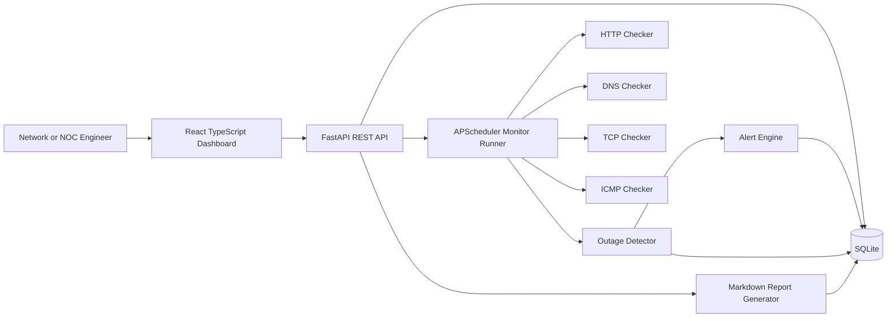

# InfraPulse

**A full-stack network monitoring and outage intelligence platform for Network Operations, NOC, SRE and cybersecurity engineering.**

InfraPulse monitors endpoints and infrastructure signals, records health-check history, detects outages, tracks alert events and generates availability reports through a web dashboard.

Built with **Python, FastAPI, React, TypeScript, SQLite and Docker Compose**, InfraPulse demonstrates practical network monitoring, troubleshooting, automation and full-stack development.

It is a portfolio-grade monitoring platform, not a replacement for enterprise solutions such as PRTG, SolarWinds, Datadog or ThousandEyes.

## Why InfraPulse?

During an incident, network and operations teams need to answer important questions:

- What is down?
- When did the problem start?
- How long has the service been unstable?
- What evidence is available for troubleshooting and escalation?
- How reliable has the service been over time?

InfraPulse brings these workflows together through scheduled health checks, outage tracking, availability calculations and operational reporting.

## Screenshots

<!-- Keep your existing screenshot links here if they already exist. -->

| Dashboard | Monitor Details | Availability Reports |
|---|---|---|
|  |  |  |

> If these screenshots do not exist yet, replace the paths above with your actual image locations after capturing screenshots of the running application.

## Features

- **Multi-protocol monitoring:** HTTP/HTTPS endpoints, DNS records, TCP ports and ICMP targets.
- **Health-check history:** Status, response latency, errors and check summaries.
- **Outage management:** Active and resolved outages with severity, duration, failed-check counts and root-cause hints.
- **Availability reporting:** 24-hour, 7-day and 30-day availability, latency, outage counts and downtime.
- **Alert history:** Store alert events in SQLite, with optional webhook delivery through `ALERT_WEBHOOK_URL`.
- **Markdown reports:** Generate downloadable availability reports.
- **Demo data:** Example infrastructure such as Core Router, Branch Firewall, DNS Resolver, Corporate Website, VPN Gateway and Database Server TCP 5432.
- **Operations dashboard:** Manage monitors and review health summaries, outage information and check history.
- **Automated monitoring:** Schedule checks at configurable intervals.
- **Containerised deployment:** Run the application with Docker Compose.
- **Automated validation:** Backend tests, frontend tests, build checks and GitHub Actions CI.

## Quick Start — Docker Compose

Docker Compose is the recommended way to run InfraPulse.

### Prerequisites

Install [Git](https://git-scm.com/downloads) and [Docker Desktop](https://www.docker.com/products/docker-desktop/) or Docker Engine with Docker Compose.

### 1. Clone the repository

```bash
git clone https://github.com/shubodaya/InfraPulse.git
cd InfraPulse
```

### 2. Start the application

```bash
docker compose up --build
```

The first run builds the required containers and may take a few minutes.

### 3. Open InfraPulse

| Component | URL |
|---|---|
| Web dashboard | http://localhost:5173 |
| Backend API | http://localhost:8000 |
| Interactive API documentation | http://localhost:8000/docs |
| API health check | http://localhost:8000/health |

The application is configured to seed demonstration data when the database is first created. SQLite data is stored in the `infrapulse_data` Docker volume.

### 4. Explore the application

1. Open the web dashboard.
2. Review the configured monitors and their current health.
3. Explore individual monitors and their check history.
4. Review active and resolved outages.
5. Inspect availability summaries and generated reports.
6. Use the interactive API documentation to explore the backend endpoints.

### Stop the application

```bash
docker compose down
```

This stops the containers while retaining the named database volume.

To inspect container logs when troubleshooting:

```bash
docker compose logs
```

## Local Development

Use this setup if you want to develop or debug the backend and frontend separately.

### Prerequisites

- Python 3.10 or a compatible Python version for the pinned backend dependencies
- Node.js and npm
- Git

### 1. Start the backend

From the repository root, run:

```powershell
cd backend
py -3.10 -m venv .venv
.\.venv\Scripts\Activate.ps1
python -m pip install -r requirements.txt
uvicorn app.main:app --reload
```

The backend should be available at http://localhost:8000.

Keep this terminal running.

### 2. Start the frontend

Open a second terminal at the repository root:

```powershell
cd frontend
npm install
npm run dev
```

Open the local URL printed by Vite, usually http://localhost:5173.

### 3. Environment configuration

The repository includes an `.env.example` file for reference. Review it before configuring environment variables for your local setup.

Optional webhook delivery can be configured using `ALERT_WEBHOOK_URL`.

## Architecture



## Tech Stack

| Layer | Technologies |
|---|---|
| Backend | Python, FastAPI |
| Data access | SQLAlchemy |
| Database | SQLite |
| Scheduling | APScheduler |
| HTTP checks | httpx |
| Frontend | React, TypeScript, Vite |
| UI and charts | Tailwind CSS, Recharts, lucide-react |
| Backend testing | pytest, pytest-asyncio |
| Frontend testing | Vitest, Testing Library |
| Deployment | Docker, Docker Compose |
| CI/CD | GitHub Actions |

## Supported Monitor Types

| Monitor type | Purpose | Example target |
|---|---|---|
| HTTP/HTTPS | Check endpoint reachability and expected HTTP status | `https://example.com/health` |
| DNS | Resolve a hostname and optionally validate the expected IP | `example.com` |
| TCP | Check connectivity to a host and port | `example.com:443` |
| ICMP | Check host reachability using the system ping utility | `192.168.1.1` |

ICMP checks depend on the availability and permissions of the platform's `ping` executable. In restricted environments, a check may be reported as degraded rather than crashing the application.

## API Reference

| Method | Endpoint | Purpose |
|---|---|---|
| GET | `/health` | API health check |
| GET | `/api/monitors` | List monitors with latest health |
| POST | `/api/monitors` | Create a monitor |
| GET | `/api/monitors/{monitor_id}` | Retrieve monitor details |
| PUT | `/api/monitors/{monitor_id}` | Update a monitor |
| DELETE | `/api/monitors/{monitor_id}` | Delete a monitor |
| POST | `/api/monitors/{monitor_id}/check-now` | Run an immediate check |
| GET | `/api/monitors/{monitor_id}/checks` | Retrieve check history |
| GET | `/api/outages` | List active and resolved outages |
| GET | `/api/reports/summary` | Retrieve dashboard summary |
| GET | `/api/reports/availability` | Retrieve availability summaries |
| GET | `/api/reports/availability/download` | Download a Markdown availability report |

For request schemas, parameters and interactive API testing, visit http://localhost:8000/docs after starting the backend.

## Monitoring Logic

Each monitor stores its target, monitor type, checking interval, timeout, optional expected HTTP status, optional expected DNS result, enabled state and tags.

APScheduler runs enabled monitors at their configured intervals and stores check results in SQLite.

- **HTTP/HTTPS:** Uses `httpx`, validates the expected status code and records response time.
- **DNS:** Resolves hostnames using Python's socket resolver and optionally validates an expected IP result.
- **TCP:** Opens a socket connection to `host:port` or `tcp://host:port` and records connection latency.
- **ICMP:** Attempts to use the platform's `ping` executable and handles restricted environments gracefully.

## Outage Detection Logic

The outage detector treats `down` and `degraded` checks as failed health signals.

- An outage opens when a failed health signal is observed.
- The active outage is updated while failures continue.
- The outage resolves when an `up` check returns.

Severity is calculated using failed-check count, duration and critical infrastructure tags:

- `low`: Initial or short failure.
- `medium`: Repeated failures or several minutes of impact.
- `high`: Many failures or a longer outage.
- `critical`: Important tagged monitors down for an extended period.

## Availability and SLA-Style Reporting

InfraPulse calculates availability for 24-hour, 7-day and 30-day windows.

- `up` checks count as available.
- `degraded` checks count as partial availability.
- `down` checks count as unavailable.

Downtime is calculated using outage overlap with the selected reporting window. Reports also include average latency, outage counts, total checks, current status and the most unstable monitors.

These metrics are intended for operational analysis and portfolio demonstration; they are not a substitute for a validated enterprise SLA measurement system.

## Testing and Validation

Run the backend tests from the repository root after installing the backend dependencies:

```powershell
cd backend
python -m pytest -q
```

Run frontend tests:

```bash
cd frontend
npm ci
npm test
```

Build the frontend:

```bash
npm run build
```

Validate the Docker Compose configuration from the repository root:

```bash
docker compose config
```

Build the containers:

```bash
docker compose build
```

GitHub Actions is configured to validate backend tests, frontend tests and the frontend build on configured pushes and pull requests.

## Project Structure

```text
InfraPulse/
├── .github/
│   └── workflows/       # GitHub Actions workflows
├── backend/
│   ├── app/
│   │   ├── routers/     # API endpoints
│   │   ├── services/    # Monitoring and business logic
│   │   ├── schemas.py   # API validation schemas
│   │   └── ...          # Other application modules
│   ├── tests/           # Backend tests
│   └── requirements.txt
├── frontend/            # React + TypeScript dashboard
├── .env.example
├── docker-compose.yml
├── pytest.ini
├── LICENSE
└── README.md
```

## Security Notes

- Keep secrets and credentials out of source control.
- Review `.env.example` before configuring the application.
- Restrict access to exposed services when deploying beyond localhost.
- Validate monitor targets and apply appropriate network destination restrictions.

Target syntax validation alone does not guarantee protection against server-side request forgery (SSRF). Destination validation and network-level restrictions are also important.

## Resume Highlights

- Built a full-stack network monitoring and outage intelligence platform tracking endpoint health, latency, outages, alert history and availability reports.
- Implemented FastAPI monitoring services for HTTP, DNS, TCP and graceful ICMP checks, with outage tracking and Markdown reporting.
- Developed a React and TypeScript operations dashboard with monitor management, health summaries, outage timelines and check history.
- Integrated Docker Compose deployment, automated testing and GitHub Actions CI.

## Interview Talking Points

- Designed monitoring checks to handle environments where ICMP permissions may be restricted.
- Modelled outage lifecycle state separately from raw check results to support auditable incident history and reporting.
- Used demonstration data to make the application easier to explore without relying entirely on external infrastructure.
- Used SQLite and Docker Compose for a portable setup, with potential extension points for PostgreSQL, alert integrations, authentication and distributed probes.
- Built tests for monitor creation, checker success and failure paths, outage transitions, availability calculations and report generation.

## Future Improvements

- Authentication and role-based access control.
- Stronger SSRF protection and destination policies.
- Distributed probes for branch offices and cloud regions.
- Prometheus and OpenTelemetry export.
- Email, Slack, Teams, PagerDuty and SIEM integrations.
- Maintenance windows and alert suppression.
- Scheduled reports and PDF export.
- Richer packet-loss and jitter statistics where platform permissions allow.

## License

InfraPulse is released under the MIT License. See [LICENSE](LICENSE) for details.
