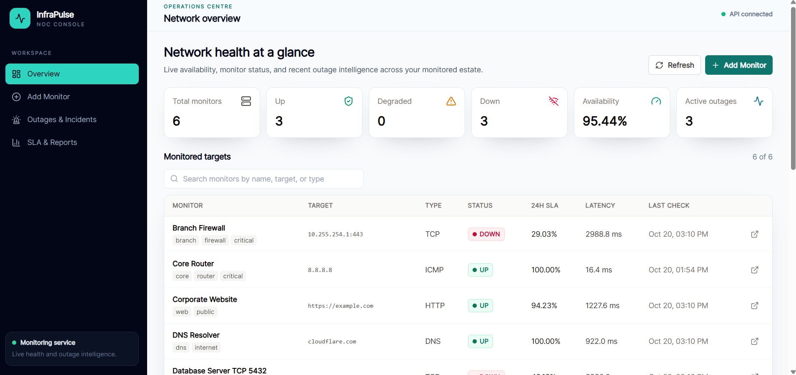
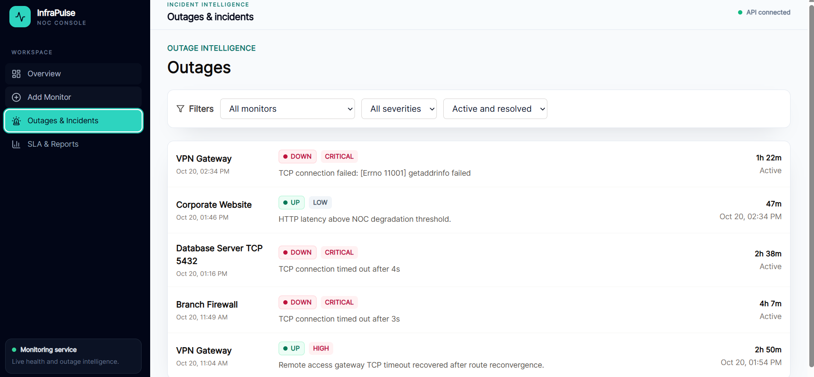
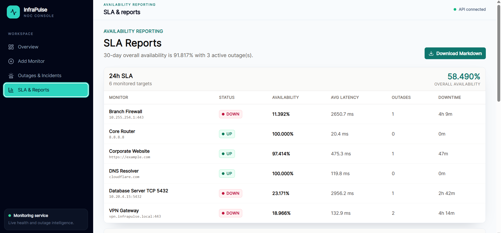
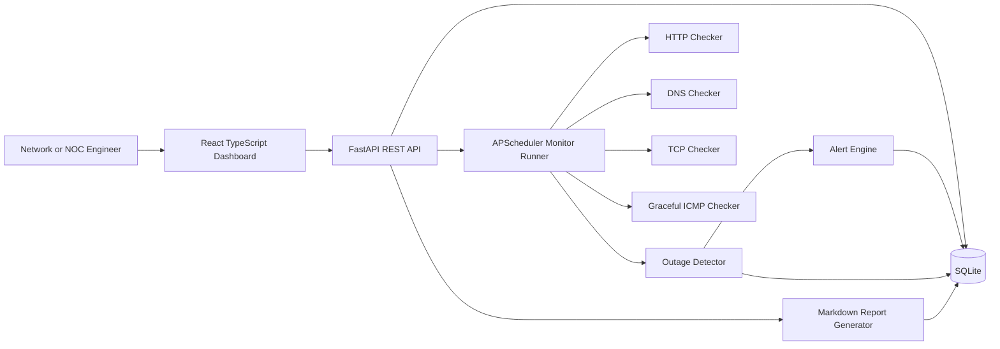

# InfraPulse

InfraPulse is a lightweight full-stack network monitoring and outage intelligence platform built for a network, NOC, SRE, or cybersecurity engineering portfolio. It monitors endpoints and infrastructure signals, stores check history, detects outage windows, records alert events, and generates SLA-style availability reports.

It is intentionally positioned as a portfolio-grade monitoring platform, not a replacement for enterprise tools such as PRTG, SolarWinds, Datadog, or ThousandEyes.

## Why This Project Matters

Network support and cybersecurity teams need clear answers during incidents: what is down, when did it start, how long has it been unstable, and what evidence supports escalation. InfraPulse demonstrates those workflows with a practical FastAPI backend, a React TypeScript operations dashboard, historical seed data, outage detection, alert records, and Markdown reporting.

## Features

- Monitor HTTP/HTTPS endpoints, DNS records, TCP ports, and ICMP ping targets.
- Track status, latency, packet loss where available, error messages, and raw check summaries.
- Detect active and resolved outages with severity, duration, failed check counts, and root cause hints.
- Calculate 24h, 7d, and 30d availability, average latency, outage counts, and downtime.
- Store alert history in SQLite, with optional webhook delivery through `ALERT_WEBHOOK_URL`.
- Generate professional Markdown availability reports.
- Seed realistic demo data for Core Router, Branch Firewall, DNS Resolver, Corporate Website, VPN Gateway, and Database Server TCP 5432.
- Run locally with Docker Compose using one command.
- Validate backend and frontend through pytest, Vitest, build checks, and GitHub Actions CI.

## Screenshots

### Network overview



### Monitor detail



### SLA reports



## Architecture



## Tech Stack

- Backend: Python, FastAPI, SQLAlchemy, SQLite, APScheduler, httpx
- Frontend: React, TypeScript, Vite, Tailwind CSS, Recharts, lucide-react
- Testing: pytest, pytest-asyncio, Vitest, Testing Library
- Deployment: Docker, Docker Compose
- CI/CD: GitHub Actions

## Quick Start With Docker

```bash
docker compose up --build
```

Open:

- Frontend: http://localhost:5173
- Backend API: http://localhost:8000
- API docs: http://localhost:8000/docs

SQLite data is stored in the `infrapulse_data` Docker volume. The API seeds demo data automatically the first time the database is created.

## Local Development

Backend:

```bash
cd backend
python -m venv .venv
.venv\Scripts\activate
pip install -r requirements.txt
uvicorn app.main:app --reload
```

Frontend:

```bash
cd frontend
npm install
npm run dev
```

Optional environment variables:

```bash
cp .env.example .env
```

## API Endpoints

| Method | Endpoint | Purpose |
| --- | --- | --- |
| GET | `/health` | API health check |
| GET | `/api/monitors` | List monitors with latest health |
| POST | `/api/monitors` | Create a monitor |
| GET | `/api/monitors/{monitor_id}` | Get monitor detail |
| PUT | `/api/monitors/{monitor_id}` | Update monitor |
| DELETE | `/api/monitors/{monitor_id}` | Delete monitor |
| POST | `/api/monitors/{monitor_id}/check-now` | Run an immediate check |
| GET | `/api/monitors/{monitor_id}/checks` | Get check history |
| GET | `/api/outages` | List active and resolved outages |
| GET | `/api/reports/summary` | Dashboard summary with alerts and periods |
| GET | `/api/reports/availability` | 24h, 7d, and 30d SLA summaries |
| GET | `/api/reports/availability/download` | Download Markdown report |

## Monitoring Logic

InfraPulse stores each configured monitor with target, type, interval, timeout, optional HTTP status expectation, optional DNS expectation, enabled state, and tags. APScheduler runs enabled monitors on their configured interval and writes each result to SQLite.

Supported monitor types:

- HTTP/HTTPS: uses `httpx`, validates the expected status code, and records response time.
- DNS: resolves hostnames with the Python socket resolver and optionally validates an expected IP result.
- TCP: opens a socket to `host:port` or `tcp://host:port` and records connect latency.
- ICMP: attempts to call the platform `ping` executable. If ping is unavailable in a container or restricted environment, the check is marked degraded with a clear error instead of crashing.

## Outage Detection Logic

The outage detector treats `down` and `degraded` checks as failed health signals. It opens an outage when a failed check is observed, updates the active outage while failures continue, and resolves it when an `up` check returns.

Severity is calculated from failed check count, duration, and critical infrastructure tags:

- `low`: initial or short failure
- `medium`: repeated failures or several minutes of impact
- `high`: many failures or longer outage duration
- `critical`: important tagged monitors down for an extended period

## SLA Calculation Logic

Availability is calculated per monitor for 24h, 7d, and 30d windows. `up` checks count as available, `degraded` checks count as partial availability, and `down` checks count as unavailable. Downtime is calculated from outage overlap with the selected reporting window. Reports also include average latency, outage count, total checks, current status, and top unstable monitors.

## Testing

Run all backend tests from the repository root:

```bash
pytest
```

Run frontend tests and build:

```bash
cd frontend
npm test
npm run build
```

Validate Docker Compose:

```bash
docker compose config
docker compose build
```

## CI/CD

GitHub Actions runs on pushes to `main` or `master` and on pull requests. The workflow installs backend dependencies, runs pytest, installs frontend dependencies with `npm ci`, runs Vitest, and builds the React app.

## Resume Bullet Points

- Built InfraPulse, a full-stack network monitoring and outage intelligence platform that tracks endpoint health, latency, outages, alert history, and SLA-style availability reports.
- Implemented FastAPI monitoring services for HTTP, DNS, TCP, and graceful ICMP checks with outage detection, downtime calculation, and Markdown report generation.
- Developed a React TypeScript NOC-style dashboard with monitor management, health summaries, outage timelines, check history, Docker Compose deployment, and CI validation.

## Interview Talking Points

- Designed a portable monitoring strategy that avoids hard failure when ICMP permissions are unavailable in containers.
- Modeled outage lifecycle state separately from raw check results, which keeps incident history and SLA calculations auditable.
- Used seeded historical data to make the product immediately demonstrable without relying on external infrastructure.
- Kept deployment simple with SQLite and Docker Compose while leaving clear extension points for Postgres, alert integrations, authentication, and distributed probes.
- Built tests around the highest-risk logic: monitor creation, checker success/failure paths, outage state transitions, SLA calculations, and report generation.

## Future Improvements

- Add authentication and role-based access controls.
- Add distributed probe agents for branch office and cloud-region checks.
- Add Prometheus/OpenTelemetry export.
- Add email, Slack, Teams, PagerDuty, or SIEM alert integrations.
- Add maintenance windows and alert suppression rules.
- Add report scheduling and PDF export.
- Add richer packet loss and jitter statistics where platform permissions allow.

